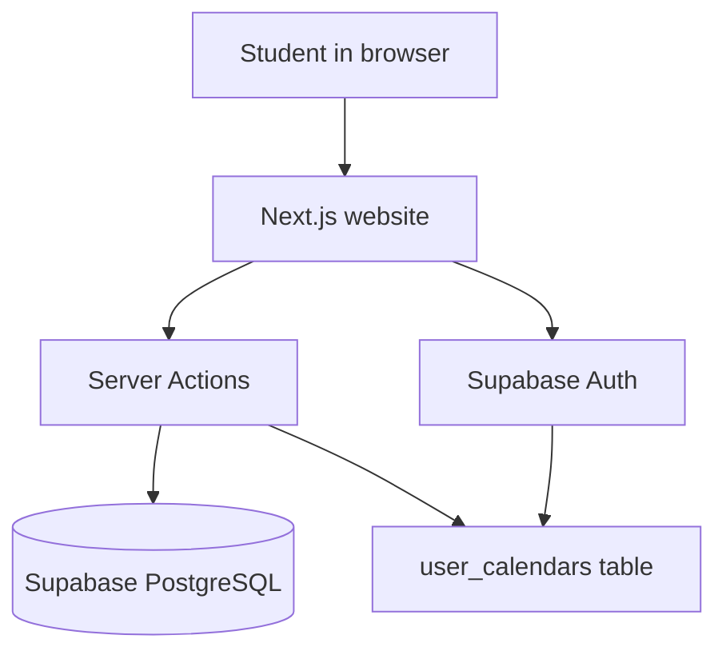

# UPV-Cal — What This Project Is (Plain English)

**UPV-Cal** is a website for **UPV students** (Universitat Politècnica de València) to find exam dates, filter them by school/degree/subject, and optionally save personal views when logged in. Think of it as a smarter, searchable exam calendar built on top of university exam data stored in the cloud.

The live product is branded **"Calendario de Exámenes UPV"** and is deployed on **Vercel**, backed by **Supabase** (database + auth).

---

## The Problem It Solves

University exam schedules are scattered and hard to browse. A student might need to answer:

- When is my Programming exam?
- What exams do I have in February for my degree?
- Can I save this filter so I don't set it up again next week?

UPV-Cal centralizes that: pick filters → see exams on a calendar or list → save the view if you have an account.

---

## How the App Is Built (Big Picture)



In practice:

1. The **website** (Next.js + React) renders pages and UI.
2. When it needs exam data, it calls **Server Actions** — server-side functions that query the database.
3. **Supabase** holds exam rows and user accounts.
4. Logged-in users can store filter presets in **`user_calendars`**.

There is also a **Java Spring Boot backend** in the `backend/` folder, but the main website **does not use it today** — it talks to Supabase directly. The Java API looks like an alternate or future layer (admin ops, heavier queries, etc.).

---

## Where the Exam Data Lives

Exam data sits in PostgreSQL tables named by academic year, e.g. **`25-26`** (~1,479 rows for ETSINF). Each row is one exam instance:

| Field | Meaning |
|-------|---------|
| `subject` / `acronym` | Course name and short code |
| `exam_date` / `exam_time` | When it happens |
| `place` | Room/location |
| `degree`, `year`, `semester` | Which program and cohort |
| `school` | Faculty (e.g. ETSINF, ETSA) |

The app maps raw DB columns into a cleaner `Exam` type used in the UI (`types/exam.ts`):

```typescript
export interface Exam {
  id: number
  subject: string
  code: string
  date: string
  time: string
  duration_minutes: number
  duration_day?: string // P1D, P2D, etc. for multi-day exams
  location: string
  comment?: string
  school: string
  degree: string
  year: string
  semester: string
  acronym?: string
  created_at?: string
}
```

Past years are browsable on `/lista-examenes-anteriores`, where you pick which table (e.g. `25-26`) to query.

---

## Main Pages and What They Do

### Homepage (`/`)

The landing page stacks:

1. **Hero + quick search** — pick school, degree, subject → jump to results
2. **Filter sidebar + calendar** — the main interactive experience
3. **Statistics** — counts/highlights
4. **FAQ**

Key file: `app/page.tsx`

### Filter + Calendar (Core UX)

`FilterConnection` wires the sidebar to the calendar (`components/filter-connection.tsx`):

- Left: `FilterSidebar` — cascading filters
- Right: `CalendarDisplay` — month grid or list view

**Filter flow (cascading):**

```
School → Degree → Semester → Year → Subject
```

Each step narrows the next. Choosing ETSINF → Computer Science → 1st semester → 2nd year → Programming shows only those exams.

Data comes from `actions/exam-actions.ts`, which queries Supabase and caches results in memory (5 min for metadata, 2 min for exam lists) to avoid hammering the DB.

### Quick Search (`FindExamCard`)

At the top of the homepage: school + degree + subject/acronym → redirects to `/exams?...` with URL params for shareable results.

Key file: `components/find-exam-card.tsx`

### Exam Results (`/exams`)

Server-rendered page that reads URL query params and shows matching exams.

Key file: `app/exams/page.tsx`

### Browse by Subject (`/lista-examenes`)

Three-column drill-down: school → subject list → exam details. Good for exploring without the calendar view.

Key file: `app/lista-examenes/page.tsx`

### Past Exams (`/lista-examenes-anteriores`)

Same idea, but you pick an academic-year table first.

Key file: `app/lista-examenes-anteriores/page.tsx`

### SEO Pages (`/[faculty]/calendarios`, `/[faculty]/[degree]/calendarios`)

Landing pages for Google — e.g. "ETSINF calendars", "Computer Science calendars". Includes structured metadata, sitemap, robots.txt.

Key files:

- `app/[faculty]/calendarios/page.tsx`
- `app/[faculty]/[degree]/calendarios/page.tsx`

### My Calendars (`/my-calendars`) — Requires Login

Saved filter presets. Each save stores a name + JSON filters in `user_calendars`:

| Column | Purpose |
|--------|---------|
| `name` | e.g. "My 2nd year exams" |
| `filters` | JSON of school/degree/subject selections |
| `user_id` | Owner |

Managed by `actions/user-calendars.ts`.

Key file: `app/my-calendars/page.tsx`

### Profile (`/profile`) — Requires Login

Account settings: theme, language preference, avatar upload, password/email changes.

Key file: `app/profile/page.tsx`

---

## Authentication

Uses **Supabase Auth**:

- Email/password sign-up and sign-in
- Google OAuth
- Sessions stored in **httpOnly cookies** (not easily readable by JS)
- Middleware refreshes sessions on protected routes

Protected-ish routes include `/my-calendars`, `/profile`, `/exams`, and `/auth/*` (`middleware.ts`).

Auth state is shared app-wide via `context/auth-context.tsx`. Login UI lives in `components/auth/` (dialog, forms, Google button, user menu).

---

## Features: Working vs. Planned/Disabled

| Feature | Status |
|---------|--------|
| Browse/filter exams | ✅ Working |
| Calendar + list views | ✅ Working |
| Save calendar views | ✅ Working (login required) |
| Quick search | ✅ Working |
| Dark/light theme | ✅ Working |
| Google Calendar export | ❌ **Disabled in UI** — button shows "temporarily disabled" |
| Full i18n (English UI) | ⚠️ **Partial** — `next-intl` is installed but UI is mostly hardcoded Spanish; language toggle exists in settings |

The README still describes Google Calendar export; the code and DB (`calendar_tokens` for ICS/webcal feeds) suggest it was built or planned but is turned off for now.

Key file: `components/export-button.tsx`

---

## Project Folder Map (What Lives Where)

| Folder | Role |
|--------|------|
| `app/` | Pages, layouts, API routes (`/api/auth/session`, avatar upload), sitemap, robots |
| `components/` | UI: calendar, filters, header, footer, auth |
| `components/ui/` | Design system (buttons, dialogs, etc. — shadcn/Radix style) |
| `actions/` | Server Actions — exam queries + saved calendars |
| `lib/` | Supabase clients, hooks, optional Spring API client |
| `context/` | Global auth + settings state |
| `utils/` | Exam mapping, date helpers |
| `types/` | TypeScript types + Supabase schema types |
| `backend/` | Java Spring Boot REST API (not wired into main UI) |
| `__tests__/` | Jest tests (many currently out of sync with code) |
| `public/` | Logos, favicons, assets |

---

## Data Flow (Step by Step)

### Example: User Filters Exams on Homepage

1. User selects "ETSINF" in `FilterSidebar`
2. Sidebar calls `getDegrees(['ETSINF'])` via a hook
3. Server Action runs on the server, queries Supabase `25-26` table
4. Results cached, returned to browser
5. User adds more filters → `CalendarDisplay` receives `activeFilters`
6. Calendar fetches exams matching all filters and renders month grid or list

### Example: User Saves a Calendar

1. User must be logged in
2. Clicks save → `SaveCalendarDialog` asks for a name
3. `saveUserCalendar()` server action writes to `user_calendars`
4. Later, `/my-calendars` loads and lists saved presets

---

## Database Schema (Key Tables)

See `database.md` for full details.

### `25-26` (Exam Data)

Stores exam information for the current academic year. ~1,479 rows for ETSINF.

### `user_calendars`

Stores user-created calendar configurations and filters.

| Column | Type | Description |
|--------|------|-------------|
| `id` | uuid | Primary key |
| `user_id` | uuid | References `auth.users(id)` |
| `name` | text | Calendar name |
| `filters` | jsonb | Filter configuration (JSON object) |
| `created_at` | timestamp | Creation timestamp |

### `calendar_tokens`

Secure tokens for calendar access via webcal/ICS feeds (supports planned export feature).

---

## Tech Stack (One Glance)

| Layer | Tech |
|-------|------|
| Frontend | Next.js 15, React 19, TypeScript, Tailwind, Radix UI, Framer Motion |
| Database | PostgreSQL via Supabase |
| Auth | Supabase Auth + cookie sessions |
| Hosting | Vercel |
| Tests | Jest + React Testing Library |
| Alt backend | Spring Boot 3.4 (Java 17) — present but unused by frontend |

---

## Configuration It Needs to Run

Key env vars (in `.env.local`, not committed):

| Variable | Purpose |
|----------|---------|
| `NEXT_PUBLIC_SUPABASE_URL` | Supabase project URL |
| `NEXT_PUBLIC_SUPABASE_ANON_KEY` | Public Supabase key |
| `NEXT_PUBLIC_EXAMS_TABLE` | Exam table name (default: `25-26`) |
| `NEXT_PUBLIC_SITE_URL` | Canonical site URL (SEO, sitemap) |
| `NEXT_PUBLIC_SPRING_API_URL` | Spring API base (default: `http://localhost:8080/api`) |
| `NEXT_PUBLIC_GOOGLE_CLIENT_ID` | Google OAuth for calendar export |
| `SUPABASE_SERVICE_ROLE_KEY` | Server-side admin Supabase access (optional) |

Without Supabase credentials, the app builds but cannot load real exam data.

---

## i18n, Theming, and SEO

### Internationalization

- `next-intl` is in `package.json` but not actively used in code
- Language toggle exists in header (`es` / `en`) and is stored in settings
- UI text is hardcoded in Spanish
- HTML default language: `lang="es"` in `app/layout.tsx`

### Theming

- Dark/light/system themes via `next-themes`
- Default theme: dark
- Stored in localStorage as `app-settings` and `upv-theme`
- Theme toggle in header and profile page

### SEO

- Metadata, Open Graph, Twitter cards in `app/layout.tsx`
- JSON-LD structured data (Organization, WebSite, SoftwareApplication)
- Dynamic sitemap from schools/degrees (`app/sitemap.ts`)
- Robots.txt with AI crawler allowances (`app/robots.ts`)
- PWA manifest (`app/manifest.ts`)
- Per-page metadata + FAQ/breadcrumb JSON-LD on faculty/degree pages

---

## Java Backend (`backend/`)

A **Spring Boot REST API** that:

- Reads/writes exam data from PostgreSQL (Supabase) via JPA
- Exposes REST endpoints at `/api/exams/*` (list, search, filter by degree/subject/year, CRUD for admins)
- Validates Supabase JWT tokens for authenticated routes
- Includes its own Supabase HTTP client mirroring the TypeScript client
- Uses Caffeine caching and connection pooling for performance
- Has health endpoint and integration/unit tests

**Important:** The Next.js frontend **does not currently call this API** for normal browsing — it talks to Supabase directly. The Java backend appears to be an alternate or future API layer, useful for heavier queries, admin operations, or mobile clients.

Local dev can run both via `start-services.bat` (Spring on :8080, Next on :3000).

---

## Testing Setup

- **Runner:** Jest 29 with jsdom (`jest.config.js`)
- **Setup:** `jest.setup.js` (mocks Supabase env vars)
- **Scripts:** `test`, `test:watch`, `test:coverage`, `test:ci` in `package.json`
- **Coverage threshold:** 70% global (branches, functions, lines, statements)
- **19 test files** covering auth, calendar, filters, profile, API routes, utils
- Backend Java tests exist separately under `backend/src/test/`

---

## Repository

- **GitHub:** https://github.com/yares28/Proves.git
- **Deployment:** Vercel (`vercel.json`)

---

## Current State of the Repo

- **Build:** Passes (`npm run build`)
- **Lint/tests:** Many pre-existing failures (tests lag behind code changes; ESLint errors on remote)
- **Git sync:** Local `main` matches `origin/main`

---

## One-Sentence Summary

> **UPV-Cal is a student-facing exam calendar for UPV: it pulls exam schedules from Supabase, lets you filter and view them on a calendar or list, save personalized views when logged in, and is set up for Google Calendar export and SEO — with the export feature currently turned off and a Java backend sitting ready but unused.**
