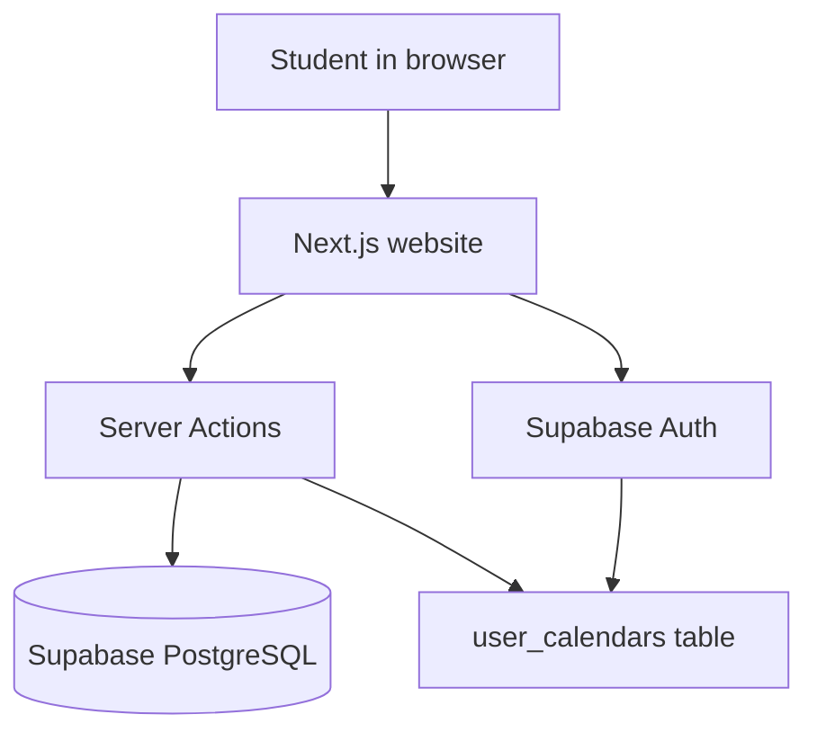

# UPV-Cal — What This Project Is (Plain English)

**UPV-Cal** is a website for **UPV students** (Universitat Politècnica de València) to find exam dates, filter them by school/degree/subject, and optionally save personal views when logged in. Think of it as a smarter, searchable exam calendar built on top of university exam data stored in the cloud.

The live product is branded **"Calendario de Exámenes UPV"** and is deployed on **Vercel**, backed by **Supabase** (database + auth).

---

## The Problem It Solves

University exam schedules are scattered and hard to browse. A student might need to answer:

- When is my Programming exam?
- What exams do I have in February for my degree?
- Can I save this filter so I don't set it up again next week?

UPV-Cal centralizes that: pick filters → see exams on a calendar or list → save the view if you have an account.

---

## How the App Is Built (Big Picture)



In practice:

1. The **website** (Next.js + React) renders pages and UI.
2. When it needs exam data, it calls **Server Actions** — server-side functions that query the database.
3. **Supabase** holds exam rows and user accounts.
4. Logged-in users can store filter presets in **`user_calendars`**.

Exam data is kept current by a **scheduled sync job** (`scraper/`, driven by `.github/workflows/sync-exams.yml`) that pulls from the official ETSINF source, validates the contract, and upserts changes into Supabase.

---

## Where the Exam Data Lives

Exam data sits in PostgreSQL tables named by academic year, e.g. **`25-26`** (~1,479 rows for ETSINF). Each row is one exam instance:

| Field | Meaning |
|-------|---------|
| `subject` / `acronym` | Course name and short code |
| `exam_date` / `exam_time` | When it happens |
| `place` | Room/location |
| `degree`, `year`, `semester` | Which program and cohort |
| `school` | Faculty (e.g. ETSINF, ETSA) |

The app maps raw DB columns into a cleaner `Exam` type used in the UI (`types/exam.ts`):

```typescript
export interface Exam {
  id: number
  subject: string
  code: string
  date: string
  time: string
  duration_minutes: number
  duration_day?: string // P1D, P2D, etc. for multi-day exams
  location: string
  comment?: string
  school: string
  degree: string
  year: string
  semester: string
  acronym?: string
  created_at?: string
}
```

Past years are browsable on `/lista-examenes-anteriores`, where you pick which table (e.g. `25-26`) to query.

---

## Main Pages and What They Do

### Homepage (`/`)

The landing page stacks:

1. **Hero + quick search** — pick school, degree, subject → jump to results
2. **Filter sidebar + calendar** — the main interactive experience
3. **Statistics** — counts/highlights
4. **FAQ**

Key file: `app/page.tsx`

### Filter + Calendar (Core UX)

`FilterConnection` wires the sidebar to the calendar (`components/filter-connection.tsx`):

- Left: `FilterSidebar` — cascading filters
- Right: `CalendarDisplay` — month grid or list view

**Filter flow (cascading):**

```
School → Degree → Semester → Year → Subject
```

Each step narrows the next. Choosing ETSINF → Computer Science → 1st semester → 2nd year → Programming shows only those exams.

Data comes from `actions/exam-actions.ts`, which queries Supabase and caches results in memory (5 min for metadata, 2 min for exam lists) to avoid hammering the DB.

### Quick Search (`FindExamCard`)

At the top of the homepage: school + degree + subject/acronym → redirects to `/exams?...` with URL params for shareable results.

Key file: `components/find-exam-card.tsx`

### Exam Results (`/exams`)

Server-rendered page that reads URL query params and shows matching exams.

Key file: `app/exams/page.tsx`

### Browse by Subject (`/lista-examenes`)

Three-column drill-down: school → subject list → exam details. Good for exploring without the calendar view.

Key file: `app/lista-examenes/page.tsx`

### Past Exams (`/lista-examenes-anteriores`)

Same idea, but you pick an academic-year table first.

Key file: `app/lista-examenes-anteriores/page.tsx`

### SEO Pages (`/[faculty]/calendarios`, `/[faculty]/[degree]/calendarios`)

Landing pages for Google — e.g. "ETSINF calendars", "Computer Science calendars". Includes structured metadata, sitemap, robots.txt.

Key files:

- `app/[faculty]/calendarios/page.tsx`
- `app/[faculty]/[degree]/calendarios/page.tsx`

### My Calendars (`/my-calendars`) — Requires Login

Saved filter presets. Each save stores a name + JSON filters in `user_calendars`:

| Column | Purpose |
|--------|---------|
| `name` | e.g. "My 2nd year exams" |
| `filters` | JSON of school/degree/subject selections |
| `user_id` | Owner |

Managed by `actions/user-calendars.ts`.

Key file: `app/my-calendars/page.tsx`

### Profile (`/profile`) — Requires Login

Account settings: theme, language preference, avatar upload, password/email changes.

Key file: `app/profile/page.tsx`

---

## Authentication

Uses **Supabase Auth**:

- Email/password sign-up and sign-in
- Google OAuth
- Sessions stored in **httpOnly cookies** (not easily readable by JS)
- Middleware refreshes sessions on protected routes

Protected-ish routes include `/my-calendars`, `/profile`, `/exams`, and `/auth/*` (`middleware.ts`).

Auth state is shared app-wide via `context/auth-context.tsx`. Login UI lives in `components/auth/` (dialog, forms, Google button, user menu).

---

## Features: Current Status

| Feature | Status |
|---------|--------|
| Browse/filter exams | ✅ Working |
| Calendar + list views | ✅ Working |
| Save calendar views | ✅ Working (login required) |
| Quick search | ✅ Working |
| Dark/light theme | ✅ Working |
| Calendar export / subscribe | ✅ Working — RFC 5545 iCalendar feed at `/api/ical`, subscribable from Google/Apple Calendar |
| Multi-language UI | ✅ Working — three locales (Castellano, Valencià, English) via `lib/messages.ts` + `hooks/use-translations`; subject names translated from the data |
| Exam conflict detection | ✅ Working — `lib/exam-conflicts.ts` flags overlapping, back-to-back and overloaded exam days |
| Installable PWA / offline | ✅ Working — manifest + `public/sw.js` service worker with an offline fallback page |

Export works by generating a live iCalendar feed rather than by calling the Google Calendar API: `components/export-button.tsx` builds a `webcal://` subscription URL pointing at `/api/ical`, so the student's calendar re-fetches and stays in sync as exam dates are corrected. `calendar_tokens` backs the planned per-user tokenised feeds.

Key files: `components/export-button.tsx`, `lib/calendar-export.ts`, `lib/ics.ts`, `app/api/ical/route.ts`

---

## Project Folder Map (What Lives Where)

| Folder | Role |
|--------|------|
| `app/` | Pages, layouts, API routes (`/api/auth/session`, avatar upload), sitemap, robots |
| `components/` | UI: calendar, filters, header, footer, auth |
| `components/ui/` | Design system (buttons, dialogs, etc. — shadcn/Radix style) |
| `actions/` | Server Actions — exam queries + saved calendars |
| `lib/` | Supabase clients, ICS builder, conflict detection, i18n catalogs, helpers |
| `context/` | Global auth + settings state |
| `utils/` | Exam mapping, date helpers |
| `types/` | TypeScript types + Supabase schema types |
| `scraper/` | Scheduled exam-data sync (own test suite, runs via GitHub Actions) |
| `__tests__/` | Jest + React Testing Library suites (21 files, 176 tests, all green) |
| `public/` | Logos, favicons, assets |

---

## Data Flow (Step by Step)

### Example: User Filters Exams on Homepage

1. User selects "ETSINF" in `FilterSidebar`
2. Sidebar calls `getDegrees(['ETSINF'])` via a hook
3. Server Action runs on the server, queries Supabase `25-26` table
4. Results cached, returned to browser
5. User adds more filters → `CalendarDisplay` receives `activeFilters`
6. Calendar fetches exams matching all filters and renders month grid or list

### Example: User Saves a Calendar

1. User must be logged in
2. Clicks save → `SaveCalendarDialog` asks for a name
3. `saveUserCalendar()` server action writes to `user_calendars`
4. Later, `/my-calendars` loads and lists saved presets

---

## Database Schema (Key Tables)

See `database.md` for full details.

### `25-26` (Exam Data)

Stores exam information for the current academic year. ~1,479 rows for ETSINF.

### `user_calendars`

Stores user-created calendar configurations and filters.

| Column | Type | Description |
|--------|------|-------------|
| `id` | uuid | Primary key |
| `user_id` | uuid | References `auth.users(id)` |
| `name` | text | Calendar name |
| `filters` | jsonb | Filter configuration (JSON object) |
| `created_at` | timestamp | Creation timestamp |

### `calendar_tokens`

Secure tokens for calendar access via webcal/ICS feeds (supports planned export feature).

---

## Tech Stack (One Glance)

| Layer | Tech |
|-------|------|
| Frontend | Next.js 15, React 19, TypeScript, Tailwind, Radix UI, Framer Motion |
| Database | PostgreSQL via Supabase |
| Auth | Supabase Auth + cookie sessions |
| Hosting | Vercel |
| Tests | Jest + React Testing Library |
| Data sync | Node scraper + GitHub Actions schedule |

---

## Configuration It Needs to Run

Key env vars (in `.env.local`, not committed):

| Variable | Purpose |
|----------|---------|
| `NEXT_PUBLIC_SUPABASE_URL` | Supabase project URL |
| `NEXT_PUBLIC_SUPABASE_ANON_KEY` | Public Supabase key |
| `NEXT_PUBLIC_EXAMS_TABLE` | Exam table name (default: `25-26`) |
| `NEXT_PUBLIC_SITE_URL` | Canonical site URL (SEO, sitemap) |
| `NEXT_PUBLIC_GOOGLE_CLIENT_ID` | Google OAuth client for Google sign-in (calendar export needs no OAuth) |
| `SUPABASE_SERVICE_ROLE_KEY` | Server-side admin Supabase access (optional) |

Without Supabase credentials, the app builds but cannot load real exam data.

---

## i18n, Theming, and SEO

### Internationalization

- `next-intl` is in `package.json` but not actively used in code
- Language toggle exists in header (`es` / `en`) and is stored in settings
- UI text is hardcoded in Spanish
- HTML default language: `lang="es"` in `app/layout.tsx`

### Theming

- Dark/light/system themes via `next-themes`
- Default theme: dark
- Stored in localStorage as `app-settings` and `upv-theme`
- Theme toggle in header and profile page

### SEO

- Metadata, Open Graph, Twitter cards in `app/layout.tsx`
- JSON-LD structured data (Organization, WebSite, SoftwareApplication)
- Dynamic sitemap from schools/degrees (`app/sitemap.ts`)
- Robots.txt with AI crawler allowances (`app/robots.ts`)
- PWA manifest (`app/manifest.ts`)
- Per-page metadata + FAQ/breadcrumb JSON-LD on faculty/degree pages

---


## Testing Setup

- **Runner:** Jest 29 with jsdom (`jest.config.js`)
- **Setup:** `jest.setup.js` (mocks Supabase env vars)
- **Scripts:** `test`, `test:watch`, `test:coverage`, `test:ci` in `package.json`
- **Coverage threshold:** 70% global (branches, functions, lines, statements)
- **21 test files / 176 tests — all passing**, covering auth, calendar, filters, conflicts, ICS export, profile, API routes and utils
- Effective coverage is ~32%, below the 70% threshold declared in `jest.config.js`; CI therefore runs the suite without `--coverage`
- The scraper has its own separate suite run before every sync

---

## Repository

- **GitHub:** https://github.com/yares28/Proves.git
- **Deployment:** Vercel (`vercel.json`)

---

## Current State of the Repo

- **Build:** Passes (`npm run build`)
- **Lint/tests:** Clean — `tsc --noEmit` passes, `npm run lint` passes (warnings only), Jest is green and is a blocking CI gate
- **CI:** `.github/workflows/ci.yml` gates type-check, lint and Jest on every push/PR; `sync-exams.yml` runs the scheduled data sync

---

## One-Sentence Summary

> **UPV-Cal is a student-facing exam calendar for UPV: it pulls exam schedules from Supabase, lets you filter and view them on a calendar or list, flags clashing exam days, saves personalized views when logged in, exports a live iCalendar feed you can subscribe to from Google or Apple Calendar, speaks three languages, installs as an offline-capable PWA, and keeps its data current through a scheduled sync job.**
